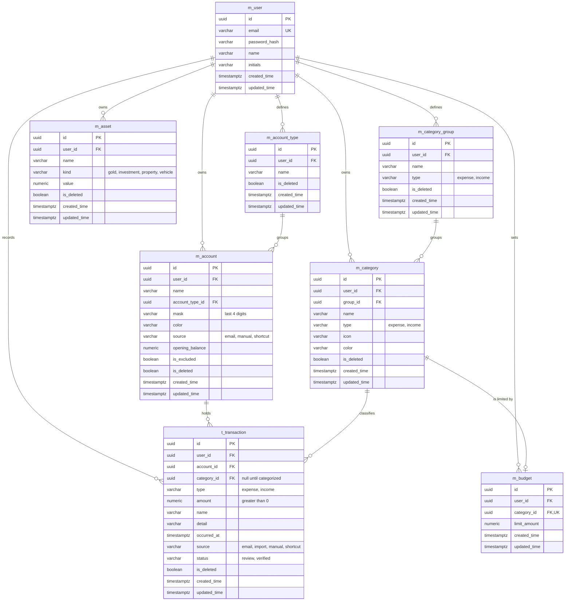

# Fynlo ERD

## Rules

- `amount`, `value`, `opening_balance`, and `limit_amount` use `numeric(18,2)`.
- Account balance is not stored. It is `opening_balance` plus income minus expenses, counting only transactions where `is_deleted` is false.
- Account types belong to one user and their names are unique per user. A type cannot be deleted while accounts still use it.
- Category groups belong to one user and have a type. Their names are unique per user and type. A group cannot be deleted while categories still use it.
- A category takes its `type` from its group, and can only move to a group of the same type. It cannot be deleted while a transaction or budget still uses it.
- A budget repeats every month, and each category has at most one.
- A budget can only point to an `expense` category, and `t_transaction.type` must match its category's `type`. The services enforce both rules.
- A transaction takes its `type` from its category. Only imported transactions can have no category, and they start in `review`.
- Statement PDFs and their passwords are never stored.
- `occurred_at` keeps seconds for imported transactions, which is how a repeated import is recognized.
- `occurred_at` is sent and shown in Asia/Jakarta time.
- Deleting an account also soft-deletes its transactions.
- Every table except `m_user` carries `user_id`. Queries must always filter by it.
- `is_deleted` keeps accounts, account types, assets, categories, category groups, and transactions recoverable. Budgets are deleted outright.
