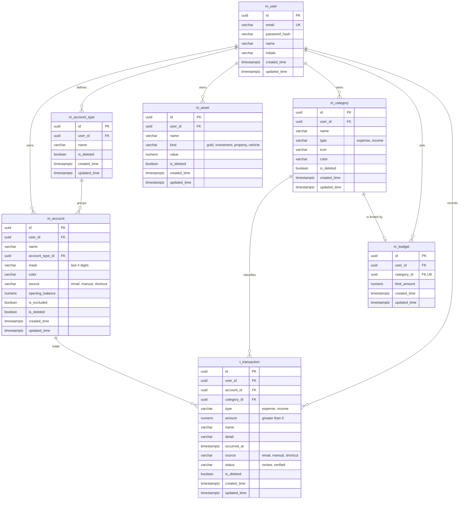

# Fynlo ERD

## Rules

- `amount`, `value`, `opening_balance`, and `limit_amount` use `numeric(18,2)`.
- Account balance is not stored. It is `opening_balance` plus income minus expenses, counting only transactions where `is_deleted` is false.
- Account types belong to one user and their names are unique per user. A type cannot be deleted while accounts still use it.
- A budget repeats every month, and each category has at most one.
- A budget can only point to an `expense` category, and `t_transaction.type` must match its category's `type`. The services enforce both rules.
- Every table except `m_user` carries `user_id`. Queries must always filter by it.
- `is_deleted` keeps accounts, account types, assets, categories, and transactions recoverable. Budgets are deleted outright.
